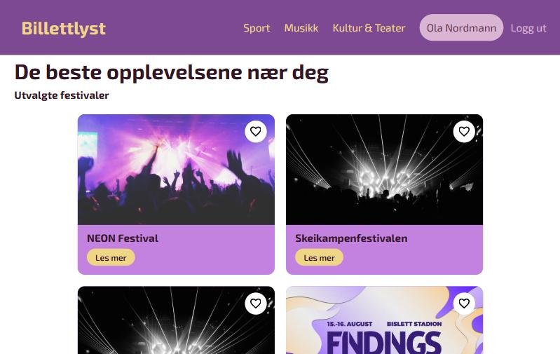
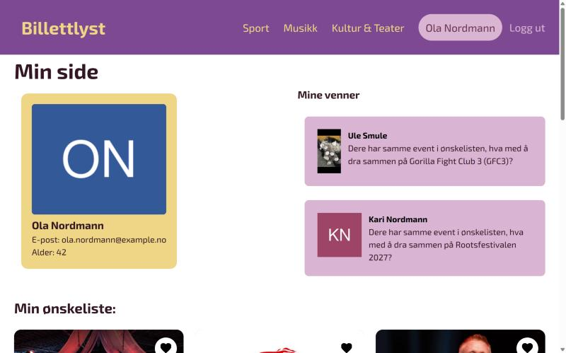
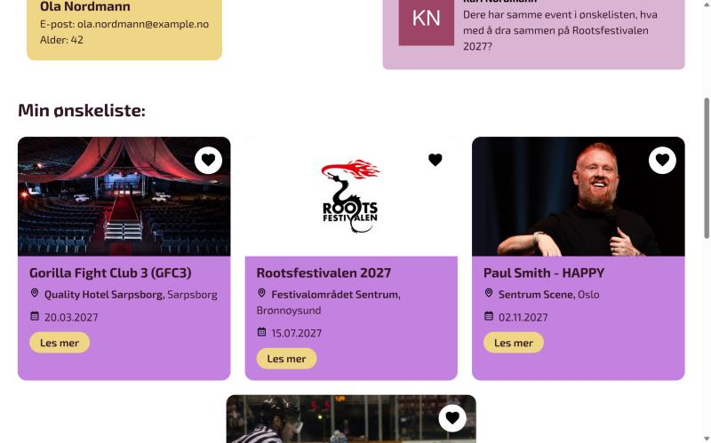
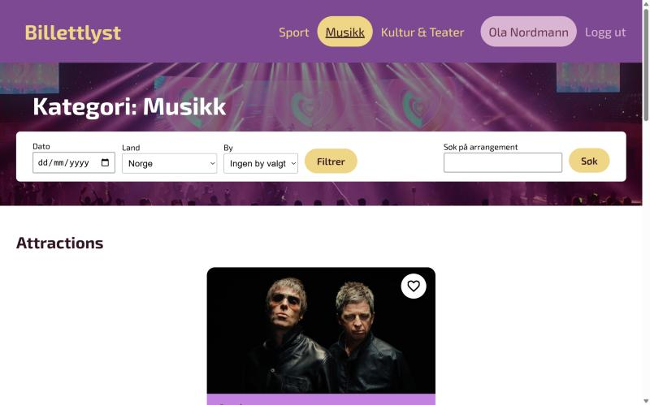

# Billettlyst

**Live demo: https://billettlyst.robertjohannessen.workers.dev**

Billettlyst ("ticket craving") is an event discovery site built as a group exam project in *Utvikling av interaktive nettsteder* (Developing Interactive Websites) at Østfold University College, spring 2025. It pulls concerts, festivals, sports and theatre from the **Ticketmaster Discovery API** and stores users, wishlists, purchases and friend lists in **Sanity**.

> **Try it:** click **Logg inn** and log in as `Ola Nordmann`, `Kari Nordmann` or `Ule Smule` (any password; the login is a course demo, not real authentication).



## Features

- Front page with selected festivals and their upcoming events
- Category pages (Sport, Music, Arts & Theatre) with filtering on date, country and city, plus free-text search
- Event pages with venue, dates and links
- "Min side" (My page) for a logged-in user:
  - profile from Sanity
  - wishlist and purchased tickets, matched against live Ticketmaster data
  - friends list that suggests going together when you and a friend have the same event on your wishlists
- Wishlist hearts on every event card, remembered in the browser
- Login remembered between visits (localStorage)

| My page | Wishlist |
|---|---|
|  |  |



## Tech stack

- **React 19** + **Vite**, React Router, SCSS
- **Sanity** (content lake + Studio) for users and saved events: GROQ queries with references between users, events and friends
- **Ticketmaster Discovery API** for live event data
- **Cloudflare Workers** for hosting the static app and a small API proxy

## My contribution

This was a four-person group project. My main focus was the **data layer and the logged-in user experience**. Measured with `git blame` on the final code:

| Area | My share |
|---|---|
| Sanity data model (`exambackend/schemaTypes`: users and events, references for wishlist, purchases and friends) | **91%** |
| User services (`brukerServices.js`: GROQ queries for user, wishlist, purchases and friends) | **72%** |
| Sanity client setup (`client.js`) | **88%** |
| "Min side" dashboard (`Dashboard.jsx`: login, remembered session, user lists) | **53%** |
| Layout and header (`Layout.jsx`, `Header.jsx`) | 53% / 39% |

Other things I built: the friends list and its styling, the reusable `EventCard` component, the first version of the category page, and the "B-requirement" tasks (listing all users and events from Sanity). My teammates did most of the visual styling and the Ticketmaster filter and event pages.

## Changes in this portfolio copy

This repository is a cleaned-up copy of the original group repo, [Rubinadragon/uin_Eksamen2025_gruppe12](https://github.com/Rubinadragon/uin_Eksamen2025_gruppe12), made so the project can run live:

- **Removed the Ticketmaster API keys** that were committed in the code, from the whole git history.
- **Added a Cloudflare Worker proxy** (`worker/index.js`). The browser calls `/api/ticketmaster/...` and the worker adds the API key on the server, so the key is never visible in the browser. Responses are cached for 5 minutes to stay within Ticketmaster's rate limits.
- **Moved the data to my own Sanity project.** The two test users with real names, photos and school emails were replaced with the fictional users Ola and Kari Nordmann.
- **Replaced expired demo events.** The original 2025 events no longer exist at Ticketmaster, so the saved events now point to upcoming events in the same categories.
- **Bug fixes:** icons and category background images used source-folder paths that only worked on the dev server; empty Ticketmaster results and unknown category URLs no longer crash the page.

## Run locally

```bash
npm install
cp .env.example .env   # add your own TICKETMASTER_API_KEY (free at developer.ticketmaster.com)
npm run dev
```

The Vite dev server proxies `/api/ticketmaster` to Ticketmaster and adds the key, just like the worker does in production.

Sanity Studio (optional):

```bash
cd exambackend
npm install
npm run dev
```

## Deploy (Cloudflare Workers)

```bash
npm run build
npx wrangler secret put TICKETMASTER_API_KEY
npx wrangler deploy
```

## Team

| | Name | GitHub |
|---|---|---|
|  | Cecilie Sellevold Vegstein | [@Rubinadragon](https://github.com/Rubinadragon) |
|  | Julie Andersen | [@JulieAnd3](https://github.com/JulieAnd3) |
|  | Kjell-Magne Larsen | [@Sell-Mango](https://github.com/Sell-Mango) |
|  | Robert Johannessen | [@Robertjohiof](https://github.com/Robertjohiof) |

Event data © Ticketmaster. Built as a student project; not affiliated with Ticketmaster.
